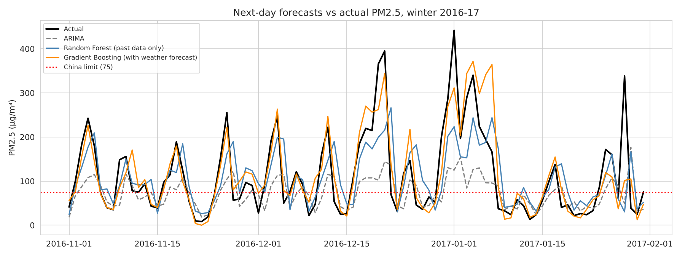
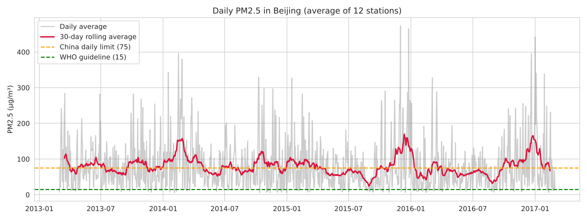
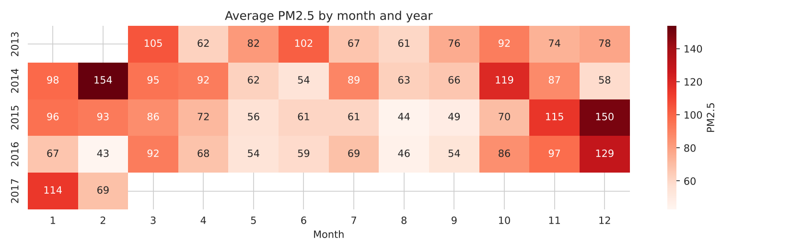
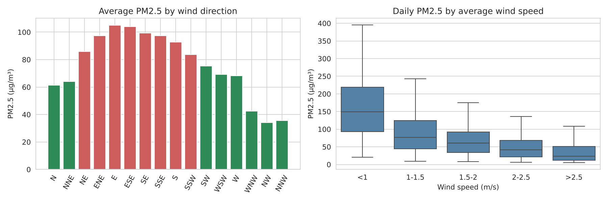
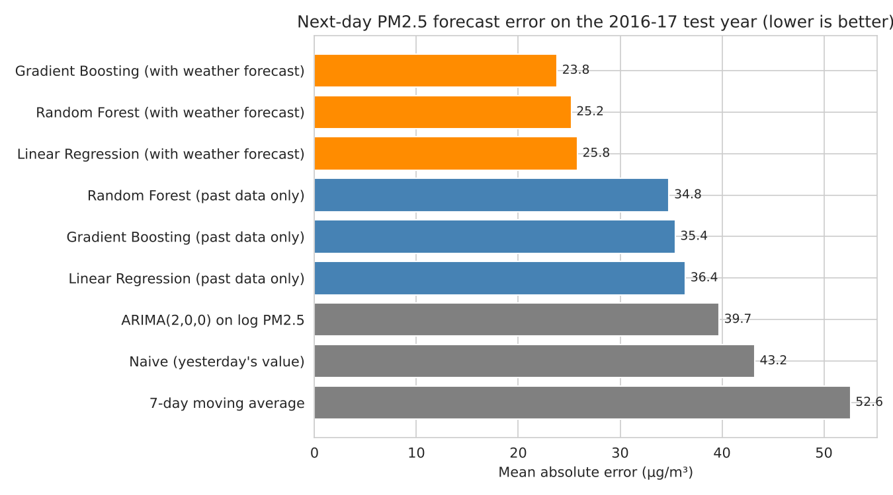

# Forecasting Beijing Air Pollution (PM2.5): ARIMA vs Machine Learning

Time series analysis and next-day forecasting of PM2.5 air pollution in Beijing. It uses 4 years of hourly data from 12 monitoring stations (35,000+ hours, 2013–2017).

The aim is to see whether an early-warning model can predict **tomorrow's** pollution well enough to alert the public before a bad air day.

*Python · pandas · statsmodels (ARIMA, ADF, ACF/PACF) · scikit-learn · matplotlib/seaborn*

---

## Key findings

| | |
|---|---|
| **Scale of the problem** | Average PM2.5 was **79.8 µg/m³**, which is **5.3× the WHO guideline**. **40%** of days broke China's own daily limit of 75 µg/m³. |
| **When it is worst** | Winter (95.7 vs 64.5 µg/m³ in summer). Each day it peaks around **10–11 pm**. |
| **Biggest driver** | **Wind**. Calm days average **157** µg/m³ and windy days **36**. North-west winds clean the air (34 µg/m³); east winds bring the worst air (105 µg/m³). |
| **Best model** | **Gradient Boosting with a weather forecast**: MAE **23.8 µg/m³**, **45% lower error** than a naive forecast, and catches **77%** of days above the limit. |
| **ARIMA vs ML** | Using only past data, Random Forest (MAE 34.8) beats ARIMA (39.7), which beats the naive forecast (43.2). |



---

## 1. Exploring the patterns ([notebook](notebooks/01_eda_pm25_patterns.ipynb))



- All 12 stations move together (average correlation **0.94**), so one city-wide average is a fair summary. The northern suburban stations (Dingling, Huairou) are the cleanest.
- Pollution is highest from **December to February**, when heating is on and cold, still air traps the particles near the ground.
- The series is **stationary** (ADF p < 0.001), and the ACF/PACF show that today's level mostly depends on yesterday's. This points to a small AR model.

| Month × year heatmap | Wind and pollution |
|---|---|
|  |  |

---

## 2. Forecasting tomorrow's PM2.5 ([notebook](notebooks/02_forecasting_arima_vs_ml.ipynb))

**Set-up**
- Train on March 2013 – February 2016; test on the **last 365 days** (March 2016 – February 2017).
- Each test day is forecast **one day ahead**, using only information available up to that day (walk-forward, no data leakage).
- ARIMA order is chosen by AIC on the training data, giving **AR(2) on log PM2.5**.
- ML features: PM2.5 lags (1, 2, 3, 7 days), 3- and 7-day averages, yesterday's weather, and month (sine/cosine) and day of week.

| Model | MAE (µg/m³) | RMSE | Bad days caught | Warnings correct |
|---|---|---|---|---|
| **Gradient Boosting + weather forecast** | **23.8** | **35.2** | 77% | **74%** |
| Random Forest + weather forecast | 25.2 | 35.7 | 75% | 70% |
| Linear Regression + weather forecast | 25.8 | 37.0 | **86%** | 71% |
| Random Forest (past data only) | 34.8 | 51.1 | 75% | 68% |
| Gradient Boosting (past data only) | 35.4 | 51.9 | 72% | 68% |
| Linear Regression (past data only) | 36.4 | 52.5 | 72% | 64% |
| ARIMA(2,0,0) on log PM2.5 | 39.7 | 59.5 | 53% | 68% |
| Naive (tomorrow = today) | 43.2 | 63.2 | 62% | 62% |
| 7-day moving average | 52.6 | 72.0 | 49% | 46% |

*"Bad days" are days above China's 75 µg/m³ limit. "Caught" is recall and "warnings correct" is precision.*



**Why the weather forecast matters:** models that use only past data are always one day late. They follow yesterday's value, so they miss the start and end of a pollution episode. Tomorrow's **wind speed** is the second most important feature after yesterday's PM2.5, because a strong north wind can clear a smog episode overnight.

---

## Conclusions

1. **Machine learning beats ARIMA** for this problem, because it can use weather and season and not only past values.
2. **An early-warning system should be built on weather forecasts.** Adding tomorrow's weather cuts the error by 45% compared with the naive forecast.
3. The best model catches about **3 in 4 bad-air days**, and about **3 in 4 of its warnings are correct**. That is useful for public health alerts.

**Limitations:** the "weather forecast" models use measured weather as a stand-in for a perfect forecast, so real-world error would be somewhat higher. The models forecast the city average only. The data ends in 2017.

**Next steps:** use archived weather forecasts, forecast 2–3 days ahead, and try SARIMAX and LSTM models.

---

## Repository structure

```
├── data/
│   ├── beijing_hourly_city.csv       # hourly city-wide averages (12 stations), 35,064 rows
│   └── station_daily_pm25.csv        # daily PM2.5 for each station
├── notebooks/
│   ├── 00_data_preparation.ipynb     # raw UCI files -> cleaned city-wide data
│   ├── 01_eda_pm25_patterns.ipynb    # trends, seasonality, weather, stationarity
│   └── 02_forecasting_arima_vs_ml.ipynb
├── images/
└── requirements.txt
```

## How to run

```bash
pip install -r requirements.txt
jupyter notebook notebooks/
```

Notebooks 01 and 02 run directly with the included data. To rebuild the data from scratch, download the raw files (link below) into `raw/` and run notebook 00.

## Data

[Beijing Multi-Site Air Quality dataset](https://archive.ics.uci.edu/dataset/501/beijing+multi+site+air+quality+data), UCI Machine Learning Repository (Chen, S., 2017), licensed CC BY 4.0. Hourly pollutant and weather readings from 12 national monitoring stations, 1 March 2013 to 28 February 2017. Missing values (a few percent per column) were filled by linear interpolation within each station.

---

*This builds on a group time-series poster from my MSc Data Science & Analytics at the University of Leeds. The forecasting comparison, walk-forward evaluation and analysis in this repo are my own extension.*

**Brijdeep Choudhary** · [LinkedIn](https://www.linkedin.com/in/brijdeep-choudhary-26b706395) · [GitHub](https://github.com/mrchoudharybrij)
